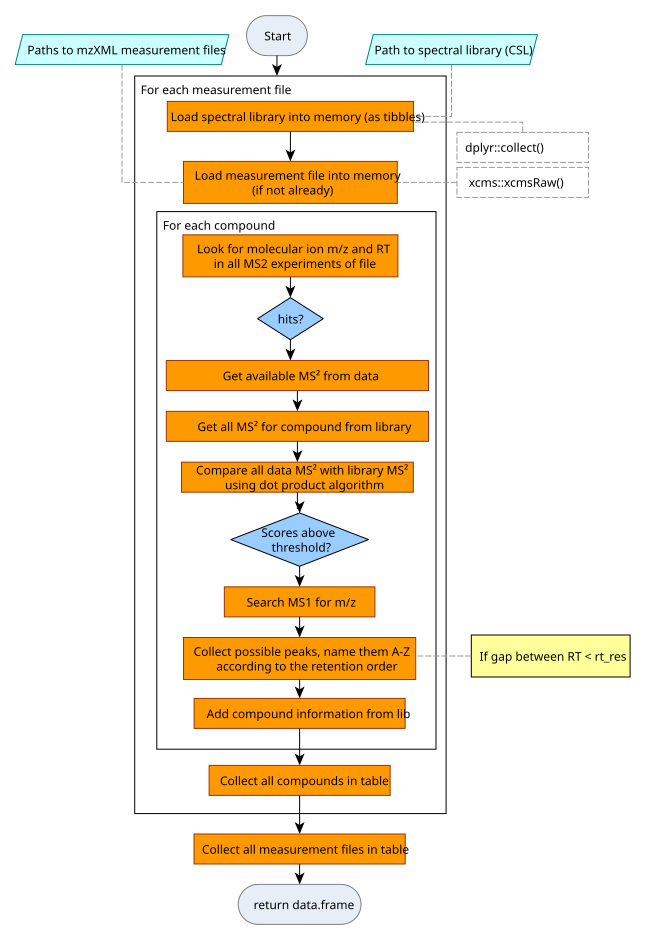

# Library screening with \`ms2_search()\`

[`ms2_search()`](http://r.bafg.de/reference/ms2_search.md) is the core
function for library screening used by `Report$process_all()`. The
function is described in \[@fig-overview-ms2_search\].

Overview of algorithm
